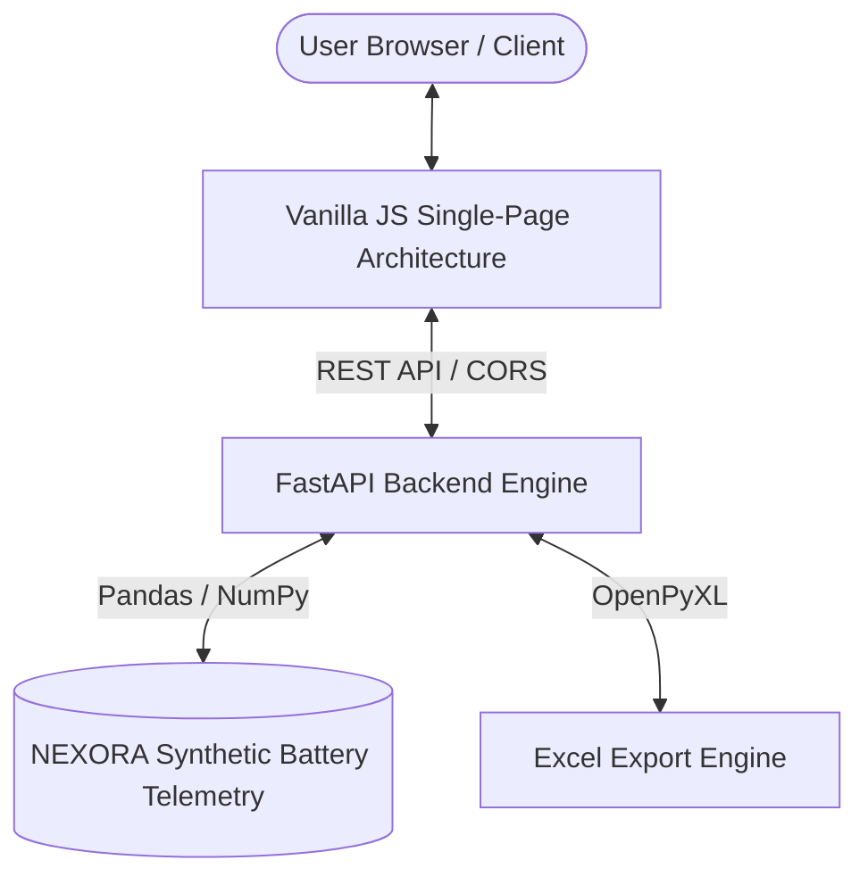

# NEXORA — AI Battery Intelligence Platform

[](https://fastapi.tiangolo.com/)
[](LICENSE)
[](https://nexora-ai-battery-intelligence.in)

**NEXORA** is an enterprise-grade AI Battery Intelligence Platform designed for real-time battery degradation monitoring, Remaining Useful Life (RUL) estimation, thermal & electrical anomaly detection, and interactive telemetry visualization.

---

## ⚡ Key Features

1. **Battery Overview Dashboard (`/dashboard.html`)**
   - Real-time State of Health (SOH %), State of Charge (SOC %), and Remaining Capacity (Ah) indicators.
   - Dynamic calendar date picker filter (`#dateSelect`) driving trajectory forecasting in real time.
   - Dual visualization formats: Toggle between **Line Chart** and **Bar Chart** views.

2. **Health & RUL Intelligence (`/health-rul.html`)**
   - Machine Learning model performance evaluation (MAE, RMSE, R² Score, MAPE across XGBoost, Random Forest, SVR, and Linear Regression).
   - End-of-Life (EOL 80% SOH) trajectory prediction horizon.

3. **Anomaly & Validation Engine (`/anomaly.html`)**
   - Automated thermal and electrical anomaly detection with confidence scores and actionable recommendations.
   - Event risk severity markers (CRITICAL, ELEVATED, WATCH).

4. **System Administrator Control Panel (`/admin.html`)**
   - Full User Management & Role Assignment (`ADMIN` vs `USER`).
   - Battery Parameter Threshold & Safety Limit Configuration.
   - Machine Learning Model Pipeline Selection & Retraining Controls.
   - Live Security & Audit Trail Logging.

5. **Data Export & Reporting**
   - One-click Excel report generation via REST API (`/api/reports/excel`).

---

## 🏗️ System Architecture



---

## 🚀 Quick Start (Local Setup)

### 1. Prerequisites
- **Python**: 3.9 or higher
- **Web Browser**: Chrome, Edge, Firefox, or Safari

### 2. Installation
Clone the repository and install required Python packages:

```bash
git clone https://github.com/YOUR_GITHUB_USERNAME/nexora-ai-battery-intelligence.git
cd nexora-ai-battery-intelligence

# Install Python dependencies
pip install fastapi uvicorn pandas numpy openpyxl
```

### 3. Running the Server
Launch the unified FastAPI backend & frontend server:

```bash
python -m uvicorn backend.main:app --host 127.0.0.1 --port 8001
```

Open your browser at:
👉 **[http://localhost:8001/](http://localhost:8001/)**

---

## 🔑 Demo Login Credentials

| Role | Username | Password | Access Level |
| :--- | :--- | :--- | :--- |
| **Admin Demo** | `nexora.admin` | `admin123` | Full Admin Control & System Settings |
| **User Demo** | `nexora.user` | `user123` | Standard Dashboard & Export Access |

---

## 🌐 Production Deployment Guide

### Deployment Overview
- **Custom Domain**: `https://nexora-ai-battery-intelligence.in`
- **Frontend Hosting**: Vercel / Netlify / GitHub Pages
- **Backend Hosting**: Render / Railway / AWS App Runner / DigitalOcean App Platform

### Environment Variables

| Variable | Description | Example |
| :--- | :--- | :--- |
| `NEXORA_API_BASE_URL` | Base URL of deployed FastAPI backend | `https://api.nexora-ai-battery-intelligence.in` |
| `ALLOWED_ORIGINS` | CORS origins allowed by FastAPI | `https://nexora-ai-battery-intelligence.in` |

---

## 📝 License
Distributed under the MIT License.
